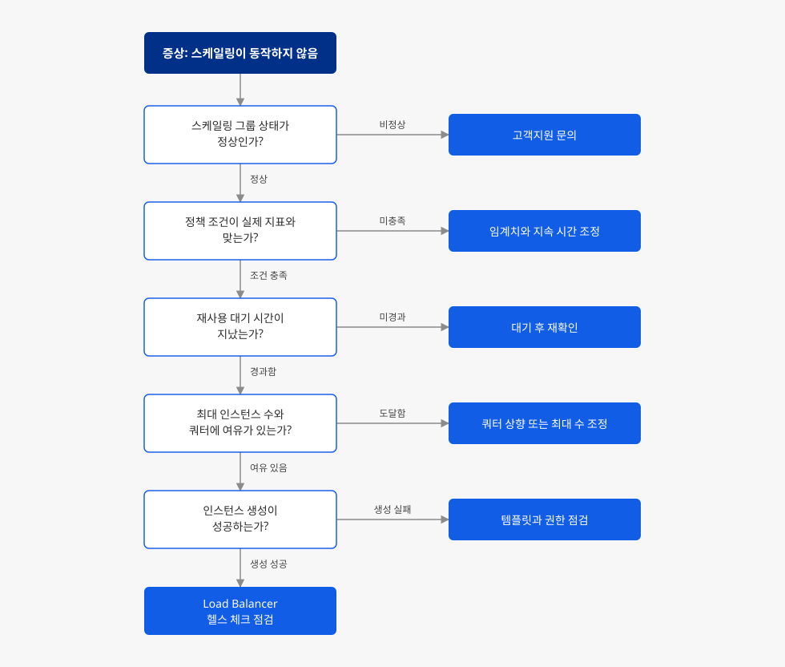

# Auto Scale 스케일링이 동작하지 않습니다

## 증상

**Compute > Auto Scale**에서 스케일링 그룹에 정책을 설정했는데, 조건을 충족해도 인스턴스 수가 기대한 대로 바뀌지 않습니다. 다음과 같은 형태로 나타납니다.

- 부하가 임계치를 넘어도 인스턴스가 증설되지 않습니다.
- 감축 정책을 실행했는데 인스턴스가 줄어들지 않고, 스케일링 그룹 상태가 `UPDATE_IN_PROGRESS`에서 바뀌지 않습니다.
- 증설된 인스턴스가 곧바로 삭제되어 인스턴스 수가 원래대로 돌아갑니다.
- 스케일링 그룹을 생성할 때 `CREATE_FAILED` 상태가 됩니다.
- 일부 인스턴스가 `CHECK_FAILED` 상태에서 복구되지 않아 스케일링 그룹을 사용할 수 없습니다.
- 예약 작업으로 **구동 인스턴스** 값을 바꿨는데 실제 인스턴스 수가 그대로입니다.

스케일링 그룹 목록의 **상태** 열은 문자열이 아니라 색상 표시로 나타납니다. 색상 표시에 마우스를 올리면 툴팁에 `CREATE_COMPLETE` 같은 상태 문자열이 표시됩니다.

## 빠른 확인

다음 세 가지를 먼저 확인하세요. 세 가지 모두 5분 안에 확인할 수 있고, 여기서 원인이 좁혀집니다.

1. 스케일링 그룹 목록의 **현재 인스턴스** 열과 **기본 정보** 탭의 **구동 인스턴스** 값을 비교합니다. 두 값은 같은 것을 가리키지 않습니다. 운영 중에 인스턴스 수를 조정하려고 **구동 인스턴스**를 바꾸고 있었다면 원인 1에 해당합니다.
2. 목록 **상태** 열의 색상 표시에 마우스를 올려 상태 문자열을 확인합니다. `CREATE_FAILED`, `UPDATE_IN_PROGRESS`, `CHECK_FAILED` 중 하나에서 바뀌지 않는다면 정책 설정과 무관한 문제이므로 원인 8로 바로 넘어갑니다.
3. **스케일링 정책** 탭에서 **재사용 대기 시간**을 확인하고 마지막 스케일링 시각과 비교합니다. 기본값은 5분이며, 이 시간이 지나지 않았다면 조건을 충족해도 정책이 발동하지 않습니다.

## 원인과 해결 방법

원인을 다음 흐름으로 좁힌 뒤, 해당하는 항목의 해결 방법을 적용하세요.

### 원인 1: 구동 인스턴스 값을 현재 인스턴스 수로 이해함

**구동 인스턴스**는 스케일링 그룹을 처음 만들 때 몇 대를 띄울지 정하는 값입니다. 콘솔의 생성 화면에도 "스케일링 그룹 생성 후 초기 구동될 인스턴스 개수를 입력하세요"로 안내됩니다. 운영이 시작된 뒤에는 증설·감축 정책이 인스턴스 수를 결정하므로, 감축 정책이 동작하면 실제 인스턴스 수는 **최소 인스턴스**까지 줄어듭니다. 이때 **구동 인스턴스** 설정값은 그대로 남아 있어, 설정값과 실제 인스턴스 수가 달라집니다. 목록 화면에서 실제 대수를 보여 주는 값은 **현재 인스턴스** 열입니다.

예약 작업으로 **구동 인스턴스**를 바꿔도 변화가 없는 경우가 있습니다. 예약 작업의 **변경 값**이 현재 설정된 **구동 인스턴스** 값과 같으면 바뀐 것이 없으므로 인스턴스 수도 그대로입니다. 설정값이 5인 상태에서 예약 작업으로 다시 5를 지정하면 아무 일도 일어나지 않습니다.

**해결 방법**

1. 운영 중에 인스턴스 수를 조정하려면 **구동 인스턴스**가 아니라 **최소 인스턴스** 값을 수정합니다. 최소 인스턴스는 스케일링 그룹이 항상 유지하는 하한이므로, 이 값을 올리면 실제 인스턴스가 그만큼 증설됩니다.
2. 수정은 **기본 정보** 탭의 **인스턴스 수** 항목에서 **변경** 버튼을 선택해 진행합니다. 최소 인스턴스, 최대 인스턴스, 구동 인스턴스를 이 화면에서 함께 조정할 수 있습니다.
3. 예약 작업으로 조정한다면 **예약 작업** 탭에서 **예약 작업 생성**을 선택하고 **변경 항목**을 최소 인스턴스로 지정합니다. 선택지는 최소 인스턴스, 최대 인스턴스, 구동 인스턴스 세 가지이고 기본 선택은 최소 인스턴스입니다. **변경 값**은 현재 설정된 최소·최대 인스턴스 사이의 값만 입력할 수 있습니다.
4. **구동 인스턴스**를 바꿔야 한다면 현재 설정값과 다른 값을 지정합니다. 같은 값으로는 스케일링이 일어나지 않습니다.

### 원인 2: 스케일링 정책 조건이 실제 지표와 맞지 않음

Auto Scale의 정책은 **증설 정책**과 **감축 정책**으로 나뉘고, 각각 **조건**, **조건 연산자**, **인스턴스 조정**을 따로 설정합니다. 조건은 "지표가 임계치를 넘은 상태가 설정한 시간 동안 지속될 때" 충족됩니다. **스케일링 정책** 탭에는 `instance : cpu > 70% 상태가 5분 동안 지속 시`와 같은 형식으로 표시됩니다. 실제 부하가 임계치 근처에서 오르내리기만 하고 설정한 시간만큼 이어지지 않으면 조건이 충족되지 않습니다.

조건을 여러 개 설정한 경우에는 **조건 연산자**도 함께 확인합니다. 기본값은 `AND`이며, 이 상태에서는 모든 조건이 동시에 충족되어야 발동하므로 조건 하나만 충족된 상태에서는 스케일링이 일어나지 않습니다.

Auto Scale이 사용하는 지표는 CPU 사용률, 메모리 사용률, 디스크 읽기/쓰기, 네트워크 데이터 송수신입니다. 애플리케이션이 느려지는 원인이 CPU가 아니라 디스크 입출력인데 CPU 사용률로 조건을 걸어 두면, 서비스가 느려져도 조건은 충족되지 않습니다.

**해결 방법**

1. **스케일링 정책** 탭에서 증설 정책과 감축 정책의 **조건**, **조건 연산자**, **인스턴스 조정** 값을 확인합니다.
2. **통계** 탭에서 같은 기간의 실제 지표값을 조회해 임계치와 대조합니다. 최근 24시간 범위로 CPU 사용률(%), 메모리 사용률(%), 디스크 읽기/쓰기(MB/s), 네트워크 데이터 송수신(KB/s) 그래프를 볼 수 있습니다. 임계치를 넘은 적이 없다면 임계치를 낮추고, 넘었지만 지속 시간이 짧다면 지속 시간을 줄입니다.
3. 병목이 되는 자원에 맞는 지표로 조건을 바꿉니다. 디스크 입출력이 병목이면 디스크 읽기/쓰기로 조건을 설정합니다.
4. 조건이 여러 개이고 하나만 충족되어도 증설해야 한다면 **조건 연산자**를 `OR`로 바꿉니다.
5. 정책을 수정하려면 **스케일링 정책** 탭의 **스케일링 그룹 정책 변경** 버튼을 선택합니다.

### 원인 3: 재사용 대기 시간이 지나지 않음

정책에는 **재사용 대기 시간**이 있습니다. 증설 정책은 "인스턴스 생성 후 N분 동안 생성을 시도하지 않습니다", 감축 정책은 "인스턴스 삭제 후 N분 동안 삭제를 시도하지 않습니다"로 동작하며, 기본값은 양쪽 모두 5분입니다. 직전 스케일링이 끝난 지 이 시간이 지나지 않았다면, 조건을 충족해도 다음 스케일링은 일어나지 않습니다.

증설과 감축의 대기 시간은 서로 독립적입니다. 증설 쪽만 줄여 두고 감축이 안 된다고 보는 경우가 있으므로, 문제가 되는 방향의 정책을 확인합니다.

이 값은 증설된 인스턴스가 부팅을 마치고 트래픽을 받기까지 걸리는 시간을 벌기 위한 장치입니다. 과도하게 줄이면 증설 효과가 지표에 반영되기 전에 다음 증설이 일어나 인스턴스가 필요 이상으로 늘어납니다.

**해결 방법**

1. **스케일링 정책** 탭에서 문제가 되는 방향의 **재사용 대기 시간** 설정값을 확인하고 마지막 스케일링 시각과 비교합니다. 대기 시간이 지나지 않았다면 남은 시간만큼 기다린 뒤 다시 확인합니다.
2. 부하가 늘어나는 속도에 비해 대기 시간이 길다면 **스케일링 그룹 정책 변경**으로 값을 줄입니다. 줄일 때는 인스턴스가 부팅을 마치고 지표에 반영되기까지 걸리는 시간보다 짧게 잡지 않습니다.

### 원인 4: 최대 인스턴스 수나 프로젝트 쿼터에 도달함

스케일링 그룹은 **최대 인스턴스**로 설정한 수를 넘겨 증설하지 않습니다. 콘솔에도 "지정한 수를 초과하여 인스턴스를 생성하지 않습니다"로 안내됩니다.

프로젝트 쿼터도 함께 확인해야 합니다. 기본 인프라 서비스의 쿼터는 인스턴스 대수가 아니라 CPU(vCore), 메모리(MB), 블록 스토리지(GB), 플로팅 IP(개) 단위로 관리됩니다. 따라서 인스턴스 대수에 여유가 있어 보여도, 증설할 인스턴스의 CPU·메모리나 루트 블록 스토리지가 남은 쿼터를 넘으면 생성이 실패합니다. 쿼터는 프로젝트의 모든 리소스가 함께 사용하므로, 다른 용도로 만들어 둔 인스턴스나 오류 상태로 남은 인스턴스도 쿼터를 점유합니다.

**해결 방법**

1. 스케일링 그룹 목록의 **최소/최대 인스턴스** 열과 **현재 인스턴스** 열을 비교합니다. 현재 인스턴스가 최대 인스턴스와 같다면 **기본 정보** 탭의 **인스턴스 수** 항목에서 **변경**을 선택해 최대 인스턴스를 올립니다.
2. 프로젝트의 **쿼터 관리** 탭에서 CPU, 메모리, 블록 스토리지, 플로팅 IP의 **쿼터**와 **사용량**을 비교합니다. 하나라도 한도에 닿아 있으면 증설이 실패합니다.
3. 사용하지 않는 인스턴스와 오류 상태로 남은 인스턴스를 정리해 쿼터를 확보합니다.
4. 정리할 수 없거나 더 많은 자원이 필요하면 해당 행의 **쿼터 조정 신청** 버튼으로 한도 상향을 신청합니다. 조정이 불가능한 리소스는 이 버튼이 비활성화되고 **사용량 문의 및 신청**으로 표시됩니다.

> [!NOTE]
> **쿼터 관리** 탭의 목록은 서비스 ADMIN 역할을 가진 사용자에게만 표시됩니다. 목록이 비어 있다면 권한을 먼저 확인하세요.

### 원인 5: 인스턴스 템플릿 설정이 유효하지 않음

스케일링 그룹은 지정된 인스턴스 템플릿으로 인스턴스를 만듭니다. 템플릿에 설정된 이미지, 인스턴스 타입, 네트워크 구성 중 하나라도 유효하지 않으면 인스턴스 생성 자체가 실패하므로, 정책은 정상으로 발동했는데 인스턴스는 늘어나지 않는 상태가 됩니다. 템플릿을 만든 뒤 이미지를 삭제했거나, 템플릿의 인스턴스 타입을 해당 가용성 영역에서 제공하지 않는 경우에 발생합니다.

> [!WARNING]
> 스케일링 그룹을 만든 뒤에 바꿀 수 있는 것은 인스턴스 수(**기본 정보** 탭의 **변경**), 스케일링 정책(**스케일링 정책** 탭의 **스케일링 그룹 정책 변경**), 로드 밸런서(목록 화면의 **로드 밸런서 변경**)입니다. 이미지, 인스턴스 타입, 키페어, 보안 그룹, 사용자 스크립트처럼 인스턴스 템플릿에서 오는 항목은 **기본 정보** 탭에 표시만 되고 변경할 수 없습니다. 새 이미지로 배포하거나 사용자 스크립트를 바꾸려면 템플릿을 새로 만들고 스케일링 그룹도 새로 생성해야 합니다.

**해결 방법**

1. **인스턴스 목록** 탭에서 생성된 인스턴스의 **상태**와 **최근 업데이트 시간**을 확인하고, **통계** 탭에서 지표가 수집되고 있는지 확인합니다. 어느 시점부터 증설이 멈췄는지 판단하는 근거가 됩니다. 탭을 연 직후에는 목록이 비어 보일 수 있으므로, 내용이 표시된 뒤에 판단하거나 **새로 고침**으로 다시 조회합니다.
2. **기본 정보** 탭에 표시된 이미지 이름과 인스턴스 타입을 확인하고, 해당 이미지가 삭제되지 않고 남아 있는지, 인스턴스 타입이 해당 가용성 영역에서 제공되는지 확인합니다.
3. 같은 템플릿으로 인스턴스를 직접 하나 생성해 봅니다. 직접 생성도 실패하면 템플릿 문제이고, 성공하면 다른 원인을 확인합니다.
4. 템플릿을 고쳐야 한다면 새 템플릿을 만들고, 그 템플릿으로 스케일링 그룹을 새로 생성한 뒤 기존 그룹에서 전환합니다.

### 원인 6: 스케일링 그룹을 만든 계정에 Load Balancer 권한이 없음

스케일링 그룹을 로드 밸런서와 연동해 구성하려면 생성 계정에 로드 밸런서 권한이 필요합니다. 콘솔의 생성 화면에도 "스케일링 그룹에 로드 밸런서를 연결하려면 Infrastructure Load Balancer ADMIN 또는 Infrastructure ADMIN 권한이 필요합니다"로 안내됩니다. 이 권한이 없으면 증설된 인스턴스를 로드 밸런서 멤버로 등록하지 못해 스케일링 그룹 생성이 `CREATE_FAILED`로 끝납니다.

같은 인스턴스 템플릿으로 다른 계정에서는 정상 생성되는데 특정 계정에서만 실패한다면 이 원인일 가능성이 높습니다. 템플릿과 정책 설정은 동일하므로 설정만 비교해서는 원인이 드러나지 않습니다.

**해결 방법**

1. 스케일링 그룹을 생성한 계정의 역할을 확인합니다. `Infrastructure Load Balancer ADMIN` 또는 `Infrastructure ADMIN` 중 하나가 있어야 합니다.
2. 권한을 부여한 뒤 스케일링 그룹을 다시 생성합니다. 이미 `CREATE_FAILED`로 남은 그룹은 삭제하고 새로 만듭니다.
3. 로드 밸런서가 선택 목록에 나타나지 않는다면 서브넷을 확인합니다. 스케일링 그룹에 선택한 서브넷과 동일한 서브넷을 사용하는 로드 밸런서만 연결할 수 있습니다.

### 원인 7: 증설된 인스턴스가 Load Balancer 헬스 체크를 통과하지 못함

증설은 정상으로 일어났지만, 새로 만들어진 인스턴스가 로드 밸런서의 헬스 체크를 통과하지 못하면 비정상 멤버로 판정됩니다. 이 상태에서는 트래픽이 분산되지 않아 기존 인스턴스의 지표가 떨어지지 않고, 증설이 반복되거나 증설 직후 감축이 일어나 인스턴스 수가 오르내립니다. 사용자 입장에서는 스케일 아웃 직후 스케일 인이 일어나는 것처럼 보입니다.

인스턴스가 부팅을 마쳐도 애플리케이션이 뜨기까지는 시간이 더 걸립니다. 헬스 체크 타임아웃이 이 시간보다 짧으면 정상적인 인스턴스도 비정상으로 판정됩니다.

**기본 정보** 탭의 **자동 복구 정책**이 사용으로 설정되어 있다면 증상이 더 뚜렷하게 나타납니다. 이 정책은 개별 인스턴스에 장애가 발생하면 해당 인스턴스를 삭제하고 새 인스턴스로 대체하므로, 애플리케이션이 기동되지 않는 템플릿으로는 인스턴스가 만들어졌다 지워지는 일이 반복됩니다.

**해결 방법**

1. **Network > Load Balancer**에서 해당 로드 밸런서의 **상세 보기**를 선택하고, **멤버 그룹** 탭에서 멤버 그룹을 선택한 뒤 **멤버** 탭을 엽니다. **장치 정보** 열에 인스턴스 이름과 ID가 표시되므로 증설된 인스턴스를 찾아 **상태** 열이 `ACTIVE`인지 확인합니다. **사용** 열이 `O`가 아니면 멤버가 비활성화된 상태입니다. 멤버 등록과 해제는 증설·감축에 맞춰 자동으로 이루어지므로, 삭제된 인스턴스가 멤버로 남아 있거나 증설된 인스턴스가 멤버에 없다면 그 자체가 비정상입니다.
2. 증설된 인스턴스에 접속해 애플리케이션이 구동되어 있고 헬스 체크 경로에 응답하는지 확인합니다.
3. 같은 멤버 그룹의 **상태 확인** 탭에서 설정을 확인합니다. **URL**, **상태 확인 포트**, **HTTP 메서드**, **HTTP 상태 코드**가 애플리케이션이 실제로 응답하는 조건과 맞아야 합니다. 응답이 늦어 실패한다면 **최대 응답 대기 시간**과 **최대 재시도 횟수**를 늘립니다. 애플리케이션이 기동을 마치는 데 걸리는 시간은 **상태 확인 주기** × **최대 재시도 횟수**보다 짧아야 증설 직후 비정상으로 판정되지 않습니다.
4. **기본 정보** 탭의 **사용자 스크립트** 내용을 확인해 애플리케이션이 자동으로 기동되는지 점검합니다. 수동 기동이 필요한 구성이라면 증설된 인스턴스는 항상 헬스 체크에 실패합니다.

### 원인 8: 스케일링 그룹이 비정상 상태에 고착됨

스케일링 그룹의 내부 상태가 정상 흐름에서 벗어나면, 정책 설정과 무관하게 모든 스케일링이 멈춥니다. 다음 두 가지 형태로 나타납니다.

- **`UPDATE_IN_PROGRESS`에서 멈춤**: 증설 과정에서 인스턴스 생성이 끝내 완료되지 않으면, 그룹이 작업을 진행 중인 상태로 남습니다. 루트 블록 스토리지 생성이 지연되어 인스턴스 생성이 중단된 사례가 확인되었습니다. 이 상태에서는 감축 정책을 실행해도 반영되지 않습니다.
- **`CHECK_FAILED`에서 복구되지 않음**: 일부 인스턴스가 점검 실패 상태로 남아 그룹 전체를 사용할 수 없습니다. 플랫폼 내부 구성 요소가 재시작되는 시점과 그룹 갱신 작업이 겹치면서 상태가 어긋난 사례가 확인되었습니다.

두 경우 모두 사용자 설정이 원인이 아니며, 콘솔에서 복구할 수 없습니다. NHN Cloud 측의 상태 정정 작업이 필요합니다.

**해결 방법**

1. 목록 **상태** 열의 색상 표시에 마우스를 올려 상태 문자열을 확인합니다. 정책을 수정하거나 **스케일링 그룹 중지** 후 **스케일링 그룹 시작**으로 상태가 바뀌는지 확인합니다. 바뀌지 않으면 콘솔에서 할 수 있는 조치는 없습니다.
2. 아래 문의하기로 진행합니다. 스케일링 그룹 ID와 상태가 멈춘 시각을 함께 전달하면 확인이 빨라집니다.
3. 비정상 상태가 유지된 기간 동안 인스턴스가 정리되지 않고 과금된 경우, 문의 시 해당 기간을 함께 알리고 과금 예외 처리를 요청합니다. 스케일링 그룹 자체는 과금되지 않지만, 그룹이 생성한 인스턴스는 생성 시점부터 과금됩니다.

## 문의하기

위 방법으로 해결되지 않으면 [NHN Cloud 고객지원](https://www.nhncloud.com/kr/support/inquiry)에 문의하세요. 스케일링 그룹의 상태 고착은 플랫폼 측 조치가 필요하므로 사용자가 직접 복구할 수 없습니다. 문의 시 다음 정보를 함께 전달하면 빠른 진단에 도움이 됩니다.

- 증상이 발생한 시각과 지속 기간(KST 기준)
- 스케일링 그룹 이름과 ID(**기본 정보** 탭의 **스케일링 그룹** 항목에 표시되며 **복사** 버튼으로 복사할 수 있습니다)
- 프로젝트 ID와 리전
- 목록 **상태** 열의 툴팁에 표시되는 상태 문자열
- 증설 정책과 감축 정책 각각의 조건, 조건 연산자, 인스턴스 조정, 재사용 대기 시간
- 예약 작업을 사용 중이라면 **예약 작업** 탭의 변경 항목, 값, Cron 표현식, 다음 실행 시간
- 최소 인스턴스, 최대 인스턴스, 구동 인스턴스 설정값과 **현재 인스턴스** 값
- **기본 정보** 탭의 이미지 이름, 인스턴스 타입, 자동 복구 정책 사용 여부
- CloudTrail의 스케일링 이벤트 내역
- 로드 밸런서와 연동한 경우 **멤버** 탭의 상태와 **상태 확인** 탭의 설정값
- 비정상 상태로 유지된 기간이 있다면 과금 예외 처리 요청 여부

## 문제 예방하기

같은 문제가 반복되지 않도록 다음을 권장합니다.

- **운영 중 인스턴스 수는 최소 인스턴스로 관리**: **구동 인스턴스**는 최초 구성에 쓰는 값입니다. 운영 중 규모 조정은 **기본 정보** 탭의 **변경**에서 **최소 인스턴스**로 하고, 예약 작업의 **변경 항목**도 같은 기준으로 설정합니다.
- **템플릿 교체 절차를 미리 설계**: 인스턴스 템플릿에서 오는 항목은 스케일링 그룹 생성 후 변경할 수 없습니다. 새 이미지로 배포하거나 사용자 스크립트의 토큰을 갱신해야 하는 구성이라면, 새 스케일링 그룹을 만들어 전환하는 절차를 운영 계획에 미리 포함합니다.
- **스케일링 그룹 생성 계정의 권한을 사전 점검**: 로드 밸런서와 연동하는 구성은 생성 계정에 `Infrastructure Load Balancer ADMIN` 또는 `Infrastructure ADMIN` 권한이 있어야 합니다. 운영 계정으로 스케일링 그룹을 처음 만들기 전에 권한을 확인합니다.
- **쿼터는 대수가 아니라 CPU·메모리·블록 스토리지 기준으로 확인**: 최대 인스턴스까지 증설했을 때 필요한 CPU, 메모리, 블록 스토리지 총량을 계산해 쿼터와 비교해 둡니다.
- **재사용 대기 시간과 지속 시간을 함께 조정**: 둘 중 하나만 줄이면 인스턴스 수가 오르내리기 쉽습니다. **통계** 탭에서 증설된 인스턴스가 지표에 반영되기까지 걸리는 시간을 확인한 뒤 두 값을 함께 맞춥니다.
- **헬스 체크 타임아웃은 애플리케이션 기동 시간 기준으로 설정**: 인스턴스 부팅 시간이 아니라 애플리케이션이 요청을 받기 시작하는 시점을 기준으로 잡습니다.
