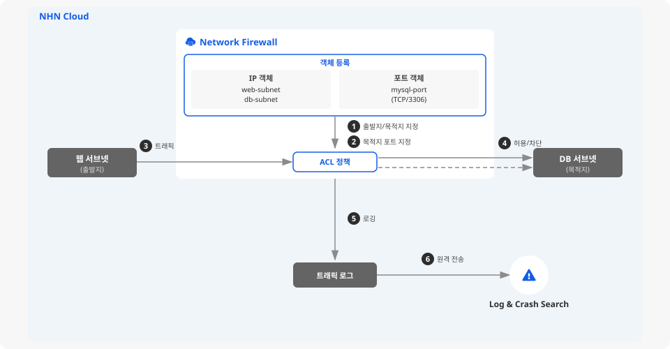

# Network Firewall 정책 구성 및 로그 전송 설정하기

## 시작하기 전에

Network Firewall은 NHN Cloud에서 사용하는 인프라 자산을 안전하게 보호하기 위해 제공하는 관리형 네트워크 보안 서비스입니다. 별도의 방화벽 제품 없이도 내·외부 통신 경로에 위치한 방화벽을 간편하게 운영할 수 있으며, VPC 간 트래픽과 인바운드·아웃바운드 트래픽을 통합적으로 제어하고 실시간 로그를 기록할 수 있습니다.

**정책**은 Network Firewall에서 트래픽을 제어하는 단위입니다. 출발지/목적지 인터페이스, 출발지, 목적지, 목적지 포트, 동작(허용 또는 차단)으로 구성된 ACL로, 조건에 맞는 트래픽을 허용하거나 차단하는 규칙입니다. 여기에서는 Network Firewall 정책에서 사용할 객체를 등록하고, 허용 정책을 추가한 뒤, 트래픽 로그를 Log & Crash Search로 전송하는 시나리오를 살펴봅니다.




**Security Groups, Network ACL과의 역할 분담**
Network Firewall, Security Groups, Network ACL은 모두 트래픽을 제어하지만, 적용 범위와 방식이 다릅니다. 각 서비스는 독립적으로 동작하므로 모두에서 허용해야 트래픽이 통과합니다. Network ACL은 Security Groups보다 먼저 적용됩니다.

| 구분 | Security Groups | Network ACL | Network Firewall |
|---|---|---|---|
| 적용 단위 | 인스턴스 | 네트워크(서브넷), 인스턴스 | VPC(서브넷) |
| 동작 | 허용만 설정 | 허용, 차단 모두 설정 | 허용, 차단 모두 설정 |
| 기본 정책 | 모든 아웃바운드 허용, 모든 인바운드 차단 | 모든 트래픽 허용(화이트리스트/블랙리스트 선택 가능) | 모든 트래픽 차단(default-deny) |
| 로그 | [Flow Log](https://www.nhncloud.com/kr/service/network/flow-log)로 수집 가능 | 미지원 | 정책별 로깅 가능 |
| 우선순위 | 없음(규칙 합집합 적용) | order 번호로 순서 지정 | 우선순위 번호로 순서 지정 |


## 사전 준비하기

- Network Firewall 서비스가 활성화되어 있고, Network Firewall 생성이 완료되어 있어야 합니다. 생성 시 VPC, 서브넷, NAT용 서브넷, 외부 전송용 서브넷을 지정해야 하므로, 보호 대상 VPC와 용도별 서브넷(보호 대상 서브넷, NAT용 서브넷, 외부 전송용 서브넷)을 미리 구성하세요. 서비스 활성화 및 Network Firewall 생성에 대한 자세한 내용은 [콘솔 사용 가이드](https://docs.nhncloud.com/ko/Security/Network-Firewall/ko/console-guide/)를 참고하세요.
- 트래픽 로그 외부 전송을 위한 Log & Crash Search 서비스가 활성화되어 있어야 합니다. Network Firewall의 트래픽 로그 외부 전송은 Syslog, Object Storage, Log & Crash Search를 지원하며, 이 가이드에서는 Log & Crash Search로 전송하는 경우를 예시로 설명합니다.


Network Firewall은 생성 시점부터 과금이 시작됩니다. 이중화(HA) 구성이 아닌 단일 구성을 선택하면 1대만 과금됩니다.


## 허용 정책 추가하기

Network Firewall은 기본 정책이 **모든 트래픽 차단**(default-deny)입니다. 따라서 필요한 트래픽만 명시적으로 허용하는 방식으로 정책을 구성합니다.

다음 예시는 웹 서브넷(192.168.20.0/24)에서 DB 서브넷(192.168.10.0/24)으로의 MySQL(TCP/3306) 접근을 허용하는 정책을 추가합니다.

### IP 객체 등록

정책에서 사용할 출발지, 목적지를 IP 객체로 먼저 등록합니다. 객체를 만들어 두면 여러 정책에서 재사용할 수 있고, IP 대역이 변경되더라도 객체만 수정하면 됩니다.

1. NHN Cloud 콘솔에서 **Security > Network Firewall**을 클릭하세요.

2. **객체** > **IP** 탭을 선택하세요.

3. **추가**를 클릭한 뒤 다음 정보를 입력해 웹 서브넷 객체를 등록합니다.

    - **이름**: `web-subnet` — 식별 가능한 이름을 입력합니다.
    - **타입**: 서브넷 — 서브넷, 범위, 그룹 중 선택합니다.
    - **IP 주소**: `192.168.20.0/24` — CIDR 형식으로 입력합니다. CIDR에 대한 자세한 내용은 하단의 [용어 알아보기](#용어-알아보기)를 참고하세요.

4. 같은 방식으로 DB 서브넷 객체도 등록합니다.

    - **이름**: `db-subnet`
    - **타입**: 서브넷
    - **IP 주소**: `192.168.10.0/24`

### 포트 객체 등록

1. NHN Cloud 콘솔에서 **Security > Network Firewall**을 클릭하세요.

2. **객체** > **포트** 탭을 선택하세요.

3. **추가**를 클릭한 뒤 다음 정보를 입력합니다.

    - **이름**: `mysql-port` — 식별 가능한 이름을 입력합니다.
    - **프로토콜**: TCP — TCP, UDP, ICMP 중 선택합니다.
    - **포트 번호**: `3306` — MySQL의 기본 포트입니다.

### 정책 추가

1. NHN Cloud 콘솔에서 **Security > Network Firewall**을 클릭하세요.

2. **정책** > **ACL** 탭으로 이동하세요.

3. **추가**를 클릭한 뒤 **정책 추가** 모달 창에서 다음 정보를 입력합니다.

    - **이름**: `allow-web-to-db-mysql` — 정책 의도를 알 수 있는 이름을 권장합니다.
    - **설명**: 웹 서브넷에서 DB 서브넷으로의 MySQL 접근 허용 — 선택 사항입니다.
    - **상태**: 활성화 — 비활성화하면 정책이 적용되지 않습니다.
    - **동작**: 허용 — 허용 또는 차단을 선택합니다.
    - **스케줄**: 항상 — 특정 시간대에만 적용하려면 스케줄을 지정합니다.
    - **로깅**: 사용 — 이 정책에 해당하는 트래픽의 로그를 기록합니다.

4. **출발지 인터페이스** 영역에서 **추가**를 클릭하면 등록된 인터페이스 목록이 나타납니다. `TRAFFIC` 인터페이스를 선택한 뒤 **확인**을 클릭하세요.

5. **목적지 인터페이스** 영역에서 **추가**를 클릭한 뒤, 마찬가지로 `TRAFFIC` 인터페이스를 선택하세요.


인터페이스는 Network Firewall 생성 시 지정한 서브넷에 자동으로 생성됩니다. **인터페이스** 탭에서 등록된 인터페이스 목록을 확인할 수 있습니다. 같은 VPC 내 서브넷 간 트래픽을 제어하려면 출발지·목적지 인터페이스 모두 `TRAFFIC`을 선택합니다.


6. **출발지** 영역에서 **추가**를 클릭하면 등록된 IP 객체 목록이 나타납니다. `web-subnet` 객체를 선택한 뒤 **확인**을 클릭하세요.

7. **목적지** 영역에서 **추가**를 클릭한 뒤, `db-subnet` 객체를 선택하세요.

8. **목적지 포트** 영역에서 **추가**를 클릭한 뒤, `mysql-port` 객체를 선택하세요.

9. **적용**을 클릭하세요.

정책이 추가되면 ACL 테이블에 새 행이 나타납니다. 새 정책은 `default-deny` 위에 자동 배정되어 더 높은 우선순위를 갖습니다. 정책은 우선순위가 높은 순서(숫자가 작은 순서)대로 평가되므로, 조건에 맞는 트래픽은 `default-deny`에 도달하기 전에 이 정책에 의해 허용됩니다.


`default-deny`는 항상 맨 아래에 위치하며, 그 아래로는 정책을 이동할 수 없습니다. 정책 간 순서를 조정하려면 **이동**을 클릭해 우선순위를 변경할 수 있습니다.


## 로그 확인 및 Log & Crash Search 연동하기

### 콘솔에서 로그 확인하기

정책에 로깅을 활성화했다면, **로그** 탭에서 트래픽 로그를 조회할 수 있습니다.

1. NHN Cloud 콘솔에서 **Security > Network Firewall**을 클릭하세요.

2. **로그** > **트래픽** 탭을 선택하세요.

3. 조회 기간을 설정합니다. 기본값은 **최근 15분**입니다.

4. 필요에 따라 필터를 지정합니다.

    - **출발지**: 출발지 IP로 필터링합니다.
    - **목적지**: 목적지 IP로 필터링합니다.
    - **목적지 포트**: 목적지 포트 번호로 필터링합니다.
    - **프로토콜**: ALL, TCP, UDP 등에서 선택합니다.
    - **동작**: ALL, 허용, 차단 중 선택합니다.

5. **검색**을 클릭하세요. 결과는 테이블 형태로 표시되며, 날짜/시간, 출발지, 목적지, 프로토콜, 출발지 포트, 목적지 포트, 동작, 정책 이름, NAT 등을 확인할 수 있습니다.


**엑셀 내려받기**를 클릭해 조회 결과를 다운로드할 수 있습니다.


### 기본 차단 정책 로그 활성화

기본 정책인 `default-deny`는 별도로 로깅을 활성화해야 로그가 기록됩니다.

1. NHN Cloud 콘솔에서 **Security > Network Firewall**을 클릭하세요.

2. **옵션** 탭을 클릭하세요.

3. **로그 설정** 영역에서 **기본 차단 정책 로그 설정**의 **설정 변경**을 클릭하세요.

4. **로그 설정**을 **사용**으로 변경한 뒤 **저장**을 클릭하세요.

이 설정을 활성화하면 어떤 정책에도 해당하지 않아 기본 차단된 트래픽도 로그에 기록됩니다. 차단된 트래픽의 출발지와 목적지를 파악할 수 있어 정책 누락을 발견하는 데 유용합니다.

### Log & Crash Search로 로그 전송하기

Network Firewall 콘솔의 **로그** 탭은 단기 조회에 적합합니다. 장기 보관이나 검색·알림이 필요하다면 Log & Crash Search로 로그를 전송하세요.

1. Log & Crash Search 서비스가 활성화되어 있는지 확인하세요. 활성화되어 있지 않다면 **서비스 선택** 화면에서 **Data & Analytics** 카테고리의 **Log & Crash Search**를 활성화하세요.

2. NHN Cloud 콘솔에서 **Security > Network Firewall**을 클릭하세요.

3. **옵션** 탭을 클릭한 뒤 **로그 설정** 영역에서 **로그 원격 전송 설정**의 **설정 변경**을 클릭하세요. 설정 화면이 나타납니다.

4. 설정 화면 상단의 **Log & Crash Search**를 클릭하세요.

5. **원격 전송**을 **사용**으로 변경하세요. **Appkey** 입력 필드에 Log & Crash Search의 Appkey를 입력한 뒤 **검증**을 클릭하세요.

6. 검증이 완료되면 **저장**을 클릭하세요.


**로그 원격 전송 설정** 화면에서 **Syslog** 또는 **Object Storage**를 선택해 Syslog 서버나 Object Storage로도 로그를 전송할 수 있습니다. Syslog를 선택하면 원격지의 IP 주소, 프로토콜(UDP/TCP), 포트 번호를 지정합니다.


## 동작 확인하기

정책이 의도한 대로 동작하는지 다음 순서로 확인합니다.


이 시나리오는 같은 VPC 내 서브넷 간 통신이므로 별도의 NAT 설정이 필요하지 않습니다. NAT 설정은 외부에서 내부로, 또는 내부에서 외부로 통신할 때만 필요합니다.


1. 웹 서브넷에 속한 인스턴스에서 DB 서브넷의 MySQL 포트로 접속을 시도합니다.

    ```sh
    mysql -h 192.168.10.x -P 3306 -u <사용자> -p
    ```


`192.168.10.x`는 DB 인스턴스의 실제 IP 주소로 바꿔 입력합니다.


2. 접속이 성공하면 정책이 정상 적용된 것입니다. **로그** > **트래픽** 탭에서 해당 트래픽이 허용 동작으로 기록되었는지 확인하세요. 반대로, 허용 정책에 해당하지 않는 트래픽(예: SSH 접속)을 시도하면 `default-deny` 정책에 의해 차단됩니다. 기본 차단 정책 로그를 활성화했다면 차단 로그도 확인할 수 있습니다.

## 응용하기

<table data-view="cards">
  <thead>
    <tr>
      <th></th>
      <th></th>
      <th></th>
      <th data-hidden data-card-target data-type="content-ref"></th>
    </tr>
  </thead>
  <tbody>
    <tr>
      <td><h4><i class="fa-list-check">:list-check:</i></h4></td>
      <td><strong>정책 일괄 등록</strong></td>
      <td>등록할 정책이 많다면 <strong>정책 일괄 등록</strong> 기능을 사용합니다. <strong>템플릿 내려받기</strong>로 양식을 받아 작성한 뒤 업로드하면 여러 정책을 한 번에 추가할 수 있습니다.</td>
      <td><a href="https://docs.nhncloud.com/ko/Security/Network-Firewall/ko/console-user-guide/policy/#batch-register-policies">https://docs.nhncloud.com/ko/Security/Network-Firewall/ko/console-user-guide/policy/#batch-register-policies</a></td>
    </tr>
    <tr>
      <td><h4><i class="fa-server">:server:</i></h4></td>
      <td><strong>인스턴스 객체 활용</strong></td>
      <td><strong>객체</strong> 탭의 <strong>인스턴스 객체 추가</strong>를 클릭하면, 프로젝트 내 인스턴스의 IP를 자동으로 가져와 객체로 등록할 수 있습니다. IP를 직접 입력하지 않아도 되므로 편리합니다.</td>
      <td><a href="https://docs.nhncloud.com/ko/Security/Network-Firewall/ko/console-user-guide/object/#add-instance-object">https://docs.nhncloud.com/ko/Security/Network-Firewall/ko/console-user-guide/object/#add-instance-object</a></td>
    </tr>
    <tr>
      <td><h4><i class="fa-clock">:clock:</i></h4></td>
      <td><strong>스케줄 기반 정책</strong></td>
      <td>특정 시간대에만 정책을 적용하려면 정책 추가 시 <strong>스케줄</strong> 항목을 지정합니다. 예를 들어, 업무 시간에만 개발 서브넷에서 운영 DB로의 접근을 허용하는 정책을 만들 수 있습니다.</td>
      <td><a href="https://docs.nhncloud.com/ko/Security/Network-Firewall/ko/console-user-guide/policy/#configure-acl">https://docs.nhncloud.com/ko/Security/Network-Firewall/ko/console-user-guide/policy/#configure-acl</a></td>
    </tr>
    <tr>
      <td><h4><i class="fa-network-wired">:network-wired:</i></h4></td>
      <td><strong>인터페이스 분리</strong></td>
      <td>이 가이드에서는 출발지·목적지 인터페이스를 모두 <code>TRAFFIC</code>으로 지정했지만, <strong>인터페이스</strong> 탭에서 Web/WAS/DB 등 용도별 인터페이스를 추가 등록하면 인터페이스 단위로 더 세분화된 정책을 구성할 수 있습니다.</td>
      <td><a href="https://docs.nhncloud.com/ko/Security/Network-Firewall/ko/console-user-guide/interface/">https://docs.nhncloud.com/ko/Security/Network-Firewall/ko/console-user-guide/interface/</a></td>
    </tr>
  </tbody>
</table>

## 리소스 정리하기

실습 목적으로 따라한 경우, 더 이상 사용하지 않는 리소스를 삭제해 불필요한 과금을 방지합니다.

1. NHN Cloud 콘솔에서 **Security > Network Firewall**을 클릭하세요.

2. **정책** > **ACL** 탭에서 `allow-web-to-db-mysql` 정책을 선택한 뒤 **삭제**를 클릭하세요.

3. **객체** > **포트** 탭에서 `mysql-port` 객체를 선택한 뒤 **삭제**를 클릭하세요.

4. **객체** > **IP** 탭에서 `web-subnet`, `db-subnet` 객체를 각각 선택한 뒤 **삭제**를 클릭하세요.

5. Log & Crash Search 연동을 해제하려면 **옵션** 탭의 **로그 원격 전송 설정**에서 **원격 전송**을 **미사용**으로 변경한 뒤 **저장**을 클릭하세요.


Network Firewall 자체를 삭제하면 등록된 모든 정책과 객체가 영구적으로 삭제됩니다. 운영 중인 환경이라면 정책과 객체만 개별 삭제하세요.


## 용어 알아보기

| 용어 | 설명 |
|---|---|
| Network Firewall | NHN Cloud에서 사용하는 인프라 자산을 안전하게 보호하기 위해 사용하는 네트워크 방화벽 서비스 |
| VPC | 가상 사설 클라우드. 논리적으로 분리된 가상의 네트워크 |
| 보안 그룹 | 인스턴스의 송수신 트래픽을 제어하는 기능 |
| 서브넷 | Subnetwork를 의미하여, IP 네트워크를 더 작은 단위로 세분화한 IP 주소 영역 |
| ACL | 접근 제어 목록. 네트워크의 유입/유출 트래픽을 제어하는 기능 |
| CIDR | 클래스 없는 도메인 간 라우팅 기법이자, IP 주소를 효율적으로 사용하기 위한 IP 주소 할당 방법. '사이더' 또는 'CIDR[씨아이디알]'로 읽음 |
| 방화벽 | 미리 정의된 보안 규칙에 기반하여 들어오고 나가는 네트워크 트래픽을 모니터링하고 제어하는 네트워크 보안 시스템 |
| 트래픽 | 일정 시간 동안 네트워크를 통해 송수신되는 데이터의 양 |
